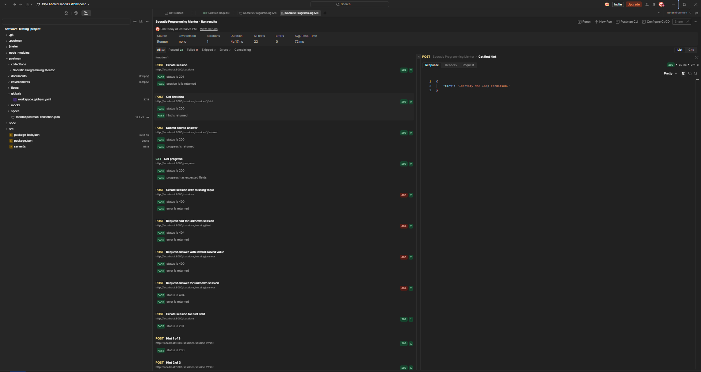
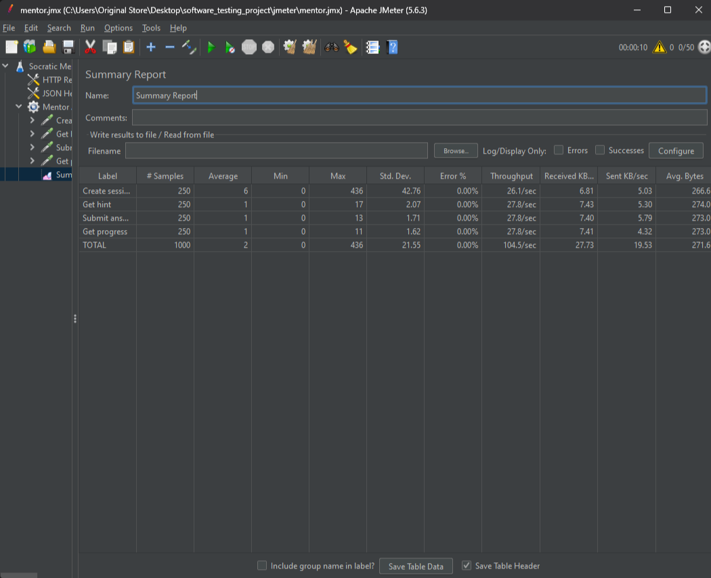

# Socratic Programming Mentor

A Node.js REST API that guides learners through programming topics using the Socratic method — offering hints one at a time and tracking progress across sessions.

## Project Structure

```
software_testing_project/
├── src/
│   ├── app.js                    # Express routes
│   ├── mentorService.js          # Session and hint logic
│   ├── progressTracker.js        # Scoring and level logic
│   └── hintProvider.js           # Hint data per topic
├── spec/
│   ├── mentorService.spec.js     # Unit tests
│   ├── progressTracker.spec.js   # Unit tests
│   ├── integration.spec.js       # Integration tests
│   └── support/jasmine.json
├── jmeter/
│   └── mentor.jmx                # JMeter performance test plan
├── postman/
│   └── mentor.postman_collection.json
├── screenshots/
│   ├── postman-results.png
│   └── jmeter-results.png
├── server.js
└── package.json
```

## API Endpoints

| Method | Endpoint | Description |
|--------|----------|-------------|
| `POST` | `/sessions` | Start a new learning session |
| `POST` | `/sessions/:id/hint` | Get the next hint for a session |
| `POST` | `/sessions/:id/answer` | Submit an answer (solved: true/false) |
| `GET`  | `/progress` | Get overall score and level |

## Scoring

- Solved with 0 hints → **100 points**
- Each hint used deducts **20 points**
- Not solved → **0 points**
- Level is `Beginner` (< 40), `Intermediate` (< 75), or `Advanced` (≥ 75)

## Getting Started

### Install dependencies

```bash
npm install
```

### Run the server

```bash
npm start
```

Server runs on `http://localhost:3000`.

### Run unit and integration tests

```bash
npm test
```

**Result: 17 specs, 0 failures, 1 pending (skipped on purpose with xit)**

## Testing

### Unit and Integration Tests — Jasmine

Tests cover `MentorService` and `ProgressTracker` using stubs, spies, driver functions, and `beforeEach`/`afterEach` hooks.

```
17 specs, 0 failures, 1 pending (skipped on purpose with xit)
```

### API Tests — Postman

The Postman collection (`postman/mentor.postman_collection.json`) contains 13 requests covering all endpoints, status codes, and edge cases.

```
22 / 22 tests passed
```



### Performance Tests — JMeter

The JMeter plan (`jmeter/mentor.jmx`) runs 50 threads × 5 loops = 250 samples per request across 4 requests, producing 1000 total samples.

```
1000 samples — 0.00% error rate
```



## Dependencies

| Package | Purpose |
|---------|---------|
| `express` | HTTP server and routing |
| `jasmine` | Unit and integration testing (dev dependency) |
